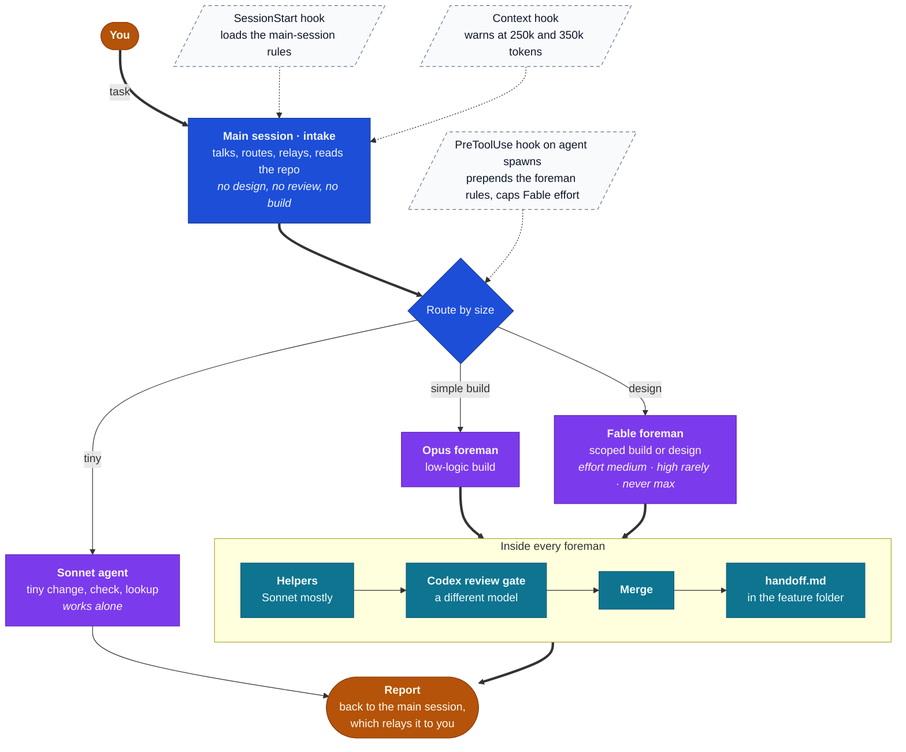
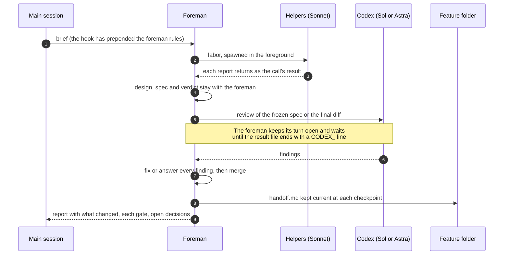
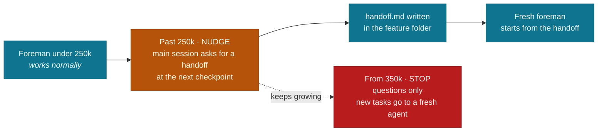
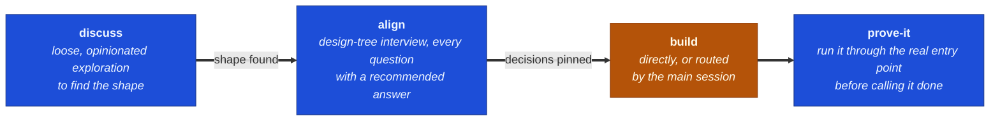
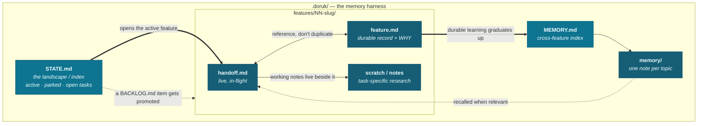

# doruk-ai-harness

**A coding harness for Claude Code, built as a system — not a pile of skills.**
One session talks to you and does nothing else. It hands each task to an agent sized for it: a
Sonnet agent for a check, an Opus foreman for a simple build, a Fable foreman for design. Every
foreman runs its own helpers, has a *different* model review the work before it merges, and leaves a
handoff on disk. Four small hooks load the rules at the right moment, so nobody has to remember them.
Around that sit a committed `.doruk/` **state & memory** layer, cross-model **delegation** in git
worktrees, and two skills that settle a design before anything is built.

[How a session is orchestrated](#how-a-session-is-orchestrated) · [All skills](#all-skills) ·
[State & memory](#state--memory-the-doruk-folder) · [Install](#install) · [Uninstall](#uninstall) ·
[Demo](#see-it-in-motion--demo-app) · [Jev Browser](#jev-browser--separate-repo) ·
[Showcase page](web/index.html)

---

## How a session is orchestrated

The whole picture first, then one block at a time. Solid boxes are sessions and agents; the slanted
boxes are hooks, which are small scripts Claude Code runs on its own at a fixed moment.



### Block 1 · You and the main session

The session you type into is **intake**. It talks with you, opens and closes agents, relays their
results, and reads the repo to answer questions. Design, code review, building, merging and deploys
all go to agents, even when a step looks small. That keeps the one conversation you read short, and
keeps the expensive model out of chat.

- **Hook: `main-hook.sh` on `SessionStart`.** It puts [`roles/main.md`](skills/delegation/orchestrate/roles/main.md)
  into the session at start, on resume, after `/clear` and after compaction, so the rules come back
  after a context wipe. It stays silent for subagents.
- **Opt-in per project.** This hook is registered in a project's own `.claude/settings.json`, so
  only the projects where you orchestrate carry the text.

### Block 2 · Routing by size

The main session picks the smallest agent that can own the task and says the route in one line as it
spawns.

| The task is | It goes to | Model |
|---|---|---|
| A config change, a tiny change, any check or lookup | One agent, no foreman | Sonnet |
| A low-logic build, where the codebase dictates the shape | A foreman | Opus |
| A scoped build, or design work | A foreman | Fable at effort `medium`; `high` rarely; never above |

- **Hook: `foreman-hook.sh` on `PreToolUse` for agent spawns.** When the main session spawns an Opus
  or Fable agent, the hook prepends [`roles/foreman.md`](skills/delegation/orchestrate/roles/foreman.md)
  to the brief, so every foreman starts with the same rules. A brief that opens with
  `Role: executor.` is left alone, for an agent that should work alone.
- **The same hook caps Fable effort.** A Fable spawn with no effort set gets `medium`, and `xhigh`
  or `max` is lowered to `high`. Sonnet spawns pass through untouched.

### Block 3 · Inside a foreman

A foreman owns its job end to end: the design decisions, the build, the reviews, the merge and the
handoff. The brief gives it the goal and what done looks like, and leaves the how to it.



- **Helpers** do exploration, data pulls, scripts and mechanical edits. They are Sonnet agents
  mostly, with an Opus helper for a piece that needs judgement. Helpers spawn nothing.
- **Review gates** are run by the foreman, and nothing merges before its gate has run. A code diff
  goes to Codex Sol. A money path or the spec of a new mechanism goes to Codex Astra. Docs and
  config with no logic need no gate. The reviewer is a different model from the builder, so no
  model grades its own work.
- **The Codex foreground wait.** This one is a rule in the foreman text and the
  [`codex`](skills/delegation/codex/SKILL.md) skill, backed by a wrapper script. A background
  "finished" notice does not reliably wake a named agent, which left agents idle for as long as 73 minutes.
  So the foreman runs Codex through [`codex-run.sh`](skills/delegation/codex/scripts/codex-run.sh),
  which caps the run and always ends its output file with a `CODEX_` line, and waits for that line:
  `until grep -q '^CODEX_' OUT; do sleep 20; done`.
- **Handoff.** The foreman keeps `handoff.md` in `.doruk/features/<feature>/` current: state,
  decisions and why, file map, open items, dead ends. A fresh foreman can start from it.

### Block 4 · Watching context size

A foreman may run to 300–400k tokens when the work needs it. The main session cannot see an agent's
context from the conversation, so a hook measures it from the agent's transcript on disk.



- **Hook: `depth-gauge.sh --hook` on `UserPromptSubmit`.** On each message you send, it prints one
  line to the main session for every agent that crossed 250k or 350k since the last warning.
- **The same script on `PreToolUse` for `SendMessage`.** When the main session messages an agent at
  350k or more, it is reminded every time.
- **It only warns.** Nothing is blocked, and the agents see no countdown of their own.
- Run `~/.claude/skills/orchestrate/depth-gauge.sh` by hand for a table of every live agent.

### The hooks in one table

| Hook | Registered in | Fires on | What it does |
|---|---|---|---|
| [`main-hook.sh`](skills/delegation/orchestrate/main-hook.sh) | The project's `.claude/settings.json` (opt-in) | `SessionStart` | Loads the main-session rules |
| [`foreman-hook.sh`](skills/delegation/orchestrate/foreman-hook.sh) | `~/.claude/settings.json` | `PreToolUse`, matcher `Agent\|Task` | Prepends the foreman rules to Opus and Fable spawns; caps Fable effort |
| [`depth-gauge.sh --hook`](skills/delegation/orchestrate/depth-gauge.sh) | `~/.claude/settings.json` | `UserPromptSubmit` | Warns once per agent at 250k and at 350k |
| `depth-gauge.sh --hook` | `~/.claude/settings.json` | `PreToolUse`, matcher `SendMessage` | Reminds on every message to an agent at 350k or more |

Each hook needs `python3`, prints nothing when it has nothing to say, and exits 0 on any error, so
it cannot break a session or a spawn. To change a rule, edit the role file; the hooks read it on
every run. Details and a three-step check that they fire:
[`HOOK-INSTALL.md`](skills/delegation/orchestrate/HOOK-INSTALL.md). Why each rule exists, with the
measurements behind it: [`references/rationale.md`](skills/delegation/orchestrate/references/rationale.md).

> **Make it yours.** The two role files are my live rules, so they name me ("Doruk") as the person
> the main session talks to, and they point at `.doruk/features/<feature>/` for handoffs (the
> [`handoff`](skills/state-memory/handoff/SKILL.md) skill's layout). Edit
> `~/.claude/skills/orchestrate/roles/*.md` after installing to put your own name, models and gates
> in. Tested on Claude Code 2.1.322 with agent teams on (`CLAUDE_CODE_EXPERIMENTAL_AGENT_TEAMS=1`).

---

## Before the build: discuss, then align

Orchestration is for work whose shape is known. Two skills get it there.



`discuss` holds off specs, plans and code while the agent brings takes and tradeoffs. `align` then
walks the open decisions as a tree, asking only those whose prerequisites are settled, at the pace
you pick (one at a time, or whole rounds). `prove-it` is model-invoked: the agent reaches for it on
its own when it is about to write tests or declare a feature done.

---

## All skills

Fourteen skills in five folders under [`skills/`](skills/). The folders are for browsing; each leaf
(`skills/<group>/<name>/SKILL.md`) is a standard Claude Code skill.

**Workflow** · [`skills/workflow/`](skills/workflow/)

| Skill | What it does |
|---|---|
| [`discuss`](skills/workflow/discuss/SKILL.md) | Loose, opinionated exploration to find a task's shape before any spec, plan or code. |
| [`align`](skills/workflow/align/SKILL.md) | Pins down every open design decision in an interview, each question with a recommended answer. |
| [`prove-it`](skills/workflow/prove-it/SKILL.md) | Exercises a finished feature through its real entry point and leaves a rerunnable check plus evidence. |

**State & memory** · [`skills/state-memory/`](skills/state-memory/)

| Skill | What it does |
|---|---|
| [`handoff`](skills/state-memory/handoff/SKILL.md) | Keeps the `.doruk/` state: the `STATE.md` board, `BACKLOG.md`, and each feature's live `handoff.md`. |
| [`feature-roadmap`](skills/state-memory/feature-roadmap/SKILL.md) | Adds a durable `roadmap.md` step list for a feature too big for one handoff. |
| [`feature-organize`](skills/state-memory/feature-organize/SKILL.md) | Distills a shipped feature's folder into a durable `feature.md` and triages the scratch files. |
| [`wrap`](skills/state-memory/wrap/SKILL.md) | End-of-session consistency checks and updates for a folder one agent owns. |

**Delegation** · [`skills/delegation/`](skills/delegation/)

| Skill | What it does |
|---|---|
| [`orchestrate`](skills/delegation/orchestrate/SKILL.md) | The orchestration rules above: two role files, three hook scripts, the context gauge and an overnight watchdog. |
| [`codex`](skills/delegation/codex/SKILL.md) | Runs the OpenAI Codex CLI as a read-only reviewer or a worktree implementer, through a wrapper that cannot hang. |
| [`gemini-delegate`](skills/delegation/gemini-delegate/SKILL.md) | Runs the Google Gemini CLI in the same two roles. |
| [`worktree-init`](skills/delegation/worktree-init/SKILL.md) | Creates an isolated git worktree, copies the local files git does not carry, and bootstraps it. |
| [`worktree-lifecycle`](skills/delegation/worktree-lifecycle/SKILL.md) | Operating manual for an agent inside a worktree: orient, build and test in isolation, clean up. |

**Understanding** · [`skills/understanding/`](skills/understanding/)

| Skill | What it does |
|---|---|
| [`explain-diff-html`](skills/understanding/explain-diff-html/SKILL.md) | Turns a diff, branch or PR into a self-contained HTML explanation with a short quiz. External; credit Geoffrey Litt. |

**Meta** · [`skills/meta/`](skills/meta/)

| Skill | What it does |
|---|---|
| [`lean-instructions`](skills/meta/lean-instructions/SKILL.md) | Rules and an audit for writing skills, `CLAUDE.md`, hooks and task prompts for frontier models. |

**Legacy** · [`skills/legacy/`](skills/legacy/README.md) holds `ship`, `codex-feedback-planning` and
`codex-task-delegator`. They are kept for reference and are not installed.

> **Honest scope.** The `codex` and `gemini-delegate` skills drive external CLIs I did not build.
> `explain-diff-html` is external, and `align` is built on Matt Pocock's `grilling` method. What is
> mine and what is not: [`PROVENANCE.md`](PROVENANCE.md).

---

## State & memory: the `.doruk/` folder

The committed `.doruk/` layer: how the harness remembers across sessions, machines, and parallel
agents. The mental model in one line: **treat the context window as RAM and `.doruk/` as the disk**.
One discipline holds it together: **reference, don't duplicate** — each fact has one home, the board
points at the record, the record points at the PR.

The folder the four state skills operate on:

```
.doruk/
├── STATE.md                # the landscape: what's in motion, what's parked  (read first)
├── MEMORY.md               # durable, cross-feature learnings (the index)
├── memory/                 # one note per topic
└── features/
    └── NN-slug/            # one folder per feature
        ├── feature.md      # durable record: orientation block + decisions + WHY
        ├── handoff.md      # live, in-flight handoff
        ├── roadmap.md      # durable step-spine (multi-step programs only)
        ├── step-0N-*/      # one folder per step, with artifacts (multi-step only)
        └── archive/        # scratch that was only true during the work (optional)
```

Committed to git on purpose — so state travels across devices (`git pull` and the memory is here),
history is a deletion backstop (trim ruthlessly; every prior version survives), and the record is
auditable. In team repos the folder is gitignored as a private workspace instead.

### How the pieces navigate

The files aren't a flat folder — they're a graph. `STATE.md` is the index you read first; it points
at the active feature; the feature's live `handoff.md` and its durable `feature.md` reference each
other; learnings that outlive a feature graduate up into the `MEMORY.md` index and get recalled later.
The discipline is **reference, don't duplicate**: each fact has exactly one home, and everything else
links to it.



**Who moves what** — the four state skills are the movers between these files:

| Navigation | Driven by |
|---|---|
| Read `STATE.md` → open the active feature's `handoff.md` → recall relevant `memory/` notes | **`handoff`** (+ recall) |
| Promote a `BACKLOG.md` item into a new `features/NN-slug/` folder | **`handoff`** |
| When a feature becomes a multi-step program: add `roadmap.md` + `step-0N-*/` folders; shrink `handoff.md` to a pin | **`feature-roadmap`** |
| On ship: distill the live `handoff.md` into the durable `feature.md`, graduate learnings into `MEMORY.md` | **`feature-organize`** |
| End of session: check the files still agree, trim the board, fix stale links | **`wrap`** |

A new session never re-reads chat logs: it orients on `STATE.md`, walks into the one feature that's
moving, and the memory is already there.

---

## Install

You need Claude Code and `python3` (for the hooks). The review gates also need the OpenAI Codex CLI,
installed and signed in: `npm i -g @openai/codex && codex auth`. `gemini-delegate` needs
`npm i -g @google/gemini-cli`.

### Quick install: skills and orchestration

```bash
git clone https://github.com/doruktarhan/doruk-ai-harness.git
cd doruk-ai-harness
./install.sh --hooks                             # 14 skills + the three user-level hooks
./install.sh --project-hook ~/code/my-project    # opt-in: main-session rules for that project
```

Then start a new Claude Code session in that project.

- **`./install.sh`** copies every skill into `~/.claude/skills/`, flattening the group folders,
  because Claude Code finds skills by name. `skills/legacy/` is skipped.
- **`--hooks`** also registers `foreman-hook.sh` and the two `depth-gauge.sh` entries in
  `~/.claude/settings.json`.
- **`--project-hook DIR`** adds the `SessionStart` hook to `DIR/.claude/settings.json`. Run it once
  per project where the main session should be intake only. The entry uses `$HOME`, so the file can
  be committed and shared.
- **`--dry-run`** with any of these prints what would change and changes nothing.

The script is safe to run twice. Installing replaces the folders named after this harness's skills,
only its own hook entries are added or removed, and it writes a timestamped backup beside any
settings file before changing it. Set
`CLAUDE_HOME` to install somewhere other than `~/.claude`.

**Check that it works.** In a new session in the opted-in project, ask: "quote the first sentence of
the orchestration rules in your context". The answer should be "Orchestration rules for the main
session." Two more checks are in [`HOOK-INSTALL.md`](skills/delegation/orchestrate/HOOK-INSTALL.md).

### Skills only

Any one of these; none of them registers a hook.

```bash
./install.sh                                         # the script, without --hooks
mkdir -p ~/.claude/skills && cp -R skills/*/*/ ~/.claude/skills/   # by hand
```

```
/plugin marketplace add doruktarhan/doruk-ai-harness
/plugin install doruk-ai-harness@doruk-ai-harness
```

The plugin route loads all 14 skills from the [`skills[]` manifest](.claude-plugin/plugin.json). The
hooks and the role files point at `~/.claude/skills/orchestrate/`, so the orchestration setup needs
the script route.

> **Configure once.** A few skills leave project-specific placeholders — base branch, test and lint
> commands, path conventions — marked inline as `<...>`. Fill them on first use.

## Uninstall

```bash
./install.sh --uninstall-hooks                          # remove the user-level hooks, keep the skills
./install.sh --remove-project-hook ~/code/my-project    # remove one project's SessionStart hook
./install.sh --uninstall                                # remove the hooks and the 14 skill folders
```

Only this harness's hook entries are removed, and only skill folders this script installed; your
other hooks and skills stay. For the
plugin route: `/plugin uninstall doruk-ai-harness@doruk-ai-harness`.

---

## See it in motion — demo app

[`demo-app/`](demo-app/) is a worked example: a **fictional, throwaway** todo-API project that exists
only to show a real, populated `.doruk/` mid-flight. Two features are live:

- **feature 01 · tag-filtering** — a plain-handoff feature (one `handoff.md` + `feature.md`). Read
  [`STATE.md`](demo-app/.doruk/STATE.md) first, then the live
  [`handoff.md`](demo-app/.doruk/features/01-tag-filtering/handoff.md) and the durable
  [`feature.md`](demo-app/.doruk/features/01-tag-filtering/feature.md).
- **feature 03 · csv-export** — a `/feature-roadmap` example: a 4-step program with a mermaid spine,
  step folders, and a pinned `handoff.md`. Read [`roadmap.md`](demo-app/.doruk/features/03-csv-export/roadmap.md)
  for the map, then [`handoff.md`](demo-app/.doruk/features/03-csv-export/handoff.md) for the pin.

A session ends; the next one rebuilds the full mental model in under a minute, with no archaeology
through chat logs.

---

## Jev Browser · separate repo

**[`doruktarhan/jev-browser`](https://github.com/doruktarhan/jev-browser)**: a skill plus the `jb`
CLI, which I extracted from [Cline](https://github.com/cline/cline)'s Jev integration (Apache-2.0)
and rebuilt as a standalone tool any coding agent can call. The agent hands a whole "find / open / fill this on a website" goal to **Jev**, TypeSafe
AI's browser-action model, in one call, and gets back a small JSON summary and a screenshot. It lives
in its own repo, with its own install and a full benchmark.

From the [72-run benchmark against Playwright MCP](https://github.com/doruktarhan/jev-browser/blob/main/benchmarks/2026-09-24/README.md):

- **Good at docs search, short forms, and listing clicks.** Python docs, react.dev, playwright.dev,
  Wikipedia, and both forms passed 3/3, in 2–5 steps.
- **Much cheaper for the calling agent.** It used 30% fewer tokens across all runs and about half
  on heavy pages (44k vs 92–118k).
- **Less reliable than Playwright MCP.** It passed 86% of runs against 100%. It failed MDN (never
  found the search box) and a GitHub file lookup, and multi-step filters needed retries.
- **Routing rule:** use Jev first for navigation. Use Playwright MCP for testing, assertions,
  network/console inspection, and whenever Jev returns `BLOCKED` or `step_limit`.

---

## Why I built this

> *First person, because it's mine and I want to be honest about why it exists, not sell it.*

Two things kept going wrong when I built with an AI agent. First, **"just build it" sessions went
sideways**: either the agent spammed me at every micro-step, or it ran off and produced a large diff
I then had to reverse-engineer and quality-check by hand. Second, **the context window is a terrible
memory**: it evaporates on compaction or a new session, it doesn't travel across machines, and it
rots silently as the model paraphrases its own earlier notes.

So I built a system instead of collecting prompts. A task starts in loose discussion, its decisions
get pinned, and then it is built by an agent sized for it, with the work reviewed by a *genuinely
different* model before it merges. The point is structural: the version that lands is the reviewed
one by construction, not because I remembered to ask for a review afterward. The memory lives on
disk in one committed `.doruk/` folder, and the context window is treated as disposable scratch.

### Why it is lean: written for Fable-class models

OpenAI's September 2026 post *"Rethinking skills and prompts for GPT-6 Astra"* argues that
scaffolding built to babysit a weaker model — broad triggers, mandatory pre-reads, CAUTION/NEVER
language — slows a frontier model down. v3 applied that here: `align` was rebuilt lean on Matt
Pocock's `grilling` method, the two Codex skills merged into `codex`, and `ship`'s scripted pipeline
gave way to `orchestrate`. The rules live in
[`skills/meta/lean-instructions`](skills/meta/lean-instructions).

v4 (November 2026) took the next step with `orchestrate` itself. A review of ten days of sessions
showed the skill's pointer was displayed 18 times and the skill was loaded 0 times, so the rules
moved out of the skill body into two short role files that hooks load at the moment they apply.
Routing by task class gave way to routing by size, and the review gates moved to the foreman, who
was already running nearly all of them.

---

## Repo layout

```
doruk-ai-harness/
├── README.md                     # you are here
├── install.sh                    # skills, hooks (--hooks), per-project hook (--project-hook), uninstall
├── LICENSE                       # MIT
├── PROVENANCE.md                 # honest attribution
├── .claude-plugin/
│   ├── plugin.json               # the doruk-ai-harness plugin (bundles all skills)
│   └── marketplace.json          # single-plugin marketplace for /plugin
├── skills/
│   ├── workflow/                 # discuss · align · prove-it
│   ├── state-memory/             # handoff · feature-roadmap · feature-organize · wrap
│   ├── delegation/               # orchestrate · codex · gemini-delegate · worktree-init · worktree-lifecycle
│   │   └── orchestrate/          # roles/main.md · roles/foreman.md · main-hook.sh · foreman-hook.sh · depth-gauge.sh
│   ├── understanding/            # explain-diff-html (third-party, imported verbatim — see PROVENANCE.md)
│   ├── meta/                     # lean-instructions
│   └── legacy/                   # ship · codex-feedback-planning · codex-task-delegator — reference only, not installed
├── docs/                         # system-and-flow, memory-system, diagram
├── demo-app/                     # worked example: a real .doruk/ mid-flight
└── web/index.html                # interactive showcase (GitHub Pages)
```

More depth: [`docs/system-and-flow.md`](docs/system-and-flow.md) (the architecture),
[`docs/memory-system.md`](docs/memory-system.md) (why the memory layer is shaped the way it is),
[`docs/diagram.md`](docs/diagram.md) (the skill map as one diagram).

---

## License & attribution

MIT — see [`LICENSE`](LICENSE). These are my own skills, built for Claude Code, except
`skills/understanding/explain-diff-html` ([external, credit Geoffrey Litt](https://gist.github.com/geoffreylitt/a29df1b5f9865506e8952488eac3d524))
and the interview method inside `skills/workflow/align` ([Matt Pocock's `grilling`](https://github.com/mattpocock/skills), MIT).
The delegation skills orchestrate external CLIs I did not build (OpenAI Codex, Google Gemini), and
`skills/legacy/ship` composed the third-party *superpowers* collection (now disabled) before it was
superseded by `orchestrate`. Full honesty on what's mine and what isn't: [`PROVENANCE.md`](PROVENANCE.md).
